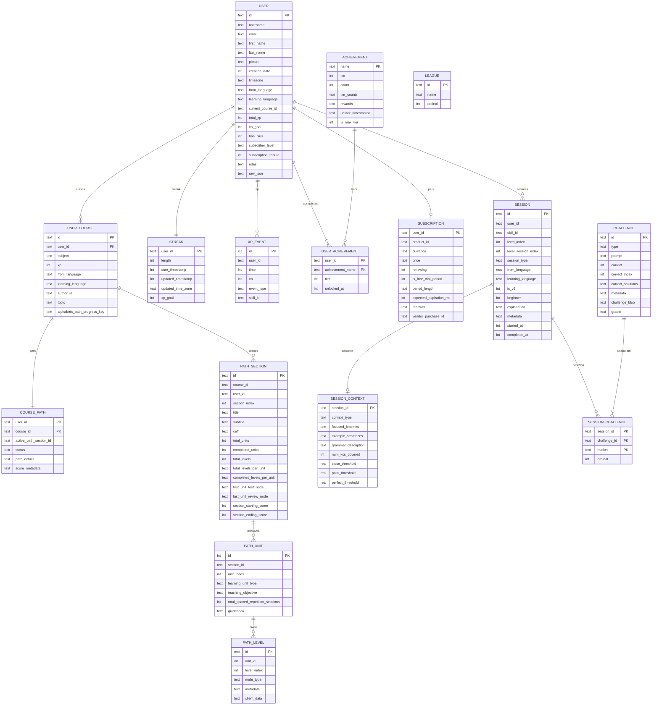

# ERD — modelo de domínio Duolingo (reconstruído)

Reconstrução de design a partir das classes Kotlin do APK 6.102.4. **Não é** o schema real do app: o app não guarda domínio em SQLite (ver `model.md`).

Legenda de evidência:

- **E** = nome de coluna extraído do descritor `kotlinx.serialization` da classe real (nome JSON da API).
- **I** = inferido (nome não recuperado no dex: campos obfuscados ou hierarquia sealed).

## Notas de modelagem

**Path.** A hierarquia real é `CoursePathInfo → sections → units → levels`, e cada nível é um nó (`PathLevelId` é só um wrapper de `String`; `PathLevelMetadata` é um `JsonElement` opaco). Por isso `path_level.metadata` e `client_data` são JSON: o app não tipa o conteúdo, então normalizar seria invenção.

**Desafios.** `Challenge` é uma sealed hierarchy com 181 campos possíveis no descritor. `type` é o discriminador (I). O resto fica em `challenge_blob` porque só um subconjunto se aplica a cada tipo.

**Sessão.** `SessionSurrogate` tem cinco listas de desafios (`challenges`, `adaptiveChallenges`, `postAdaptiveChallenges`, `mistakesReplacementChallenges`, `adaptiveInterleavedChallenges`). Uma tabela de junção com `bucket` cobre todas sem duplicar esquema.

**Streak.** `StreakData` tem 5 campos; o `streak` numérico do `User` é redundante e pode ser derivado de `streak.length`.

**Liga.** `League` é enum fixo de 10 tiers, não entidade persistida. O ranking semanal vem da API e não é cacheado em SQL — não há tabela de standings porque não há evidência de modelo local para ela.

**User.** 81 campos no descritor. Só os de uso local viraram coluna; os outros 60 ficam em `raw_json` para não inventar semântica.
